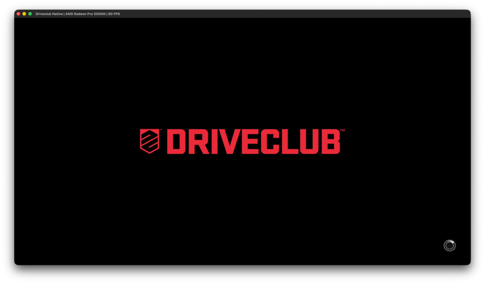
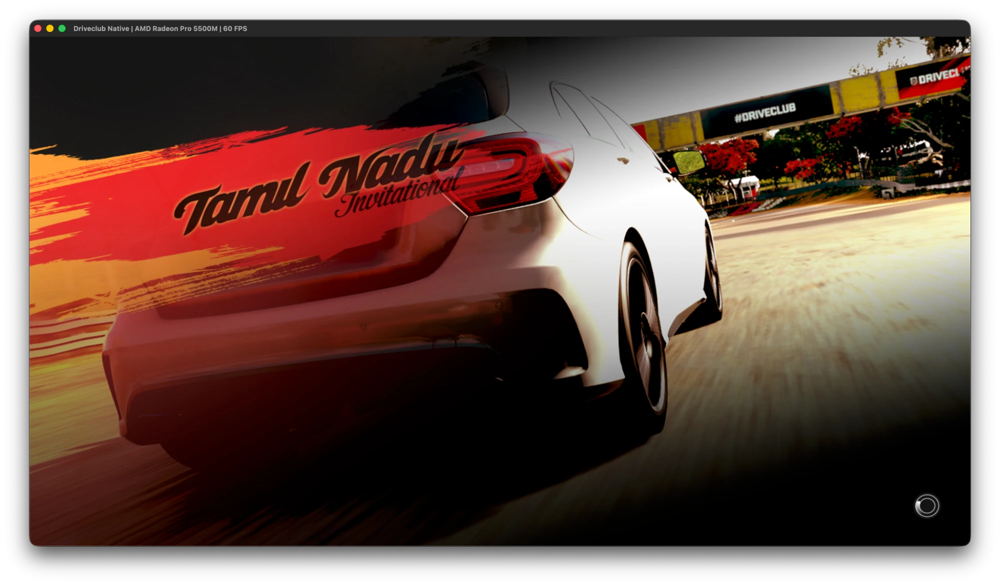
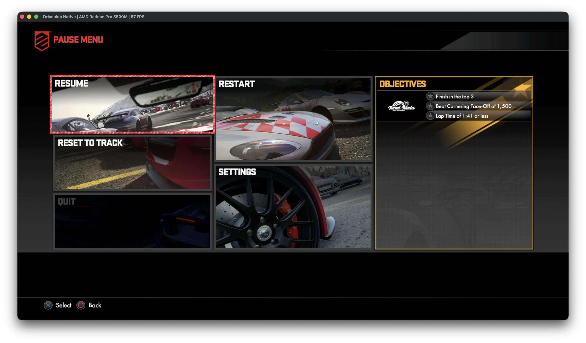

# Driveclub Native

[](https://ko-fi.com/blacklineinteractive)
[](https://www.patreon.com/BlacklineInteractive)
[](https://youtube.com/@blacklineinteractive)





A native port of **Driveclub** (PS4, CUSA00003 v1.05) to macOS with rendering via **Metal 3**.

This is not a general-purpose emulator. PS4 code is x86-64, so on Intel Macs it executes directly without CPU recompilation. We only replace what is console-specific: Sony system libraries (HLE) and the AMD Liverpool GPU (GCN) - with a custom Metal renderer tailored specifically for this single game.

## Architecture

```
eboot.bin (x86-64, natively executed)
   │  imports of 922 functions from 57 libraries
   ▼
Sony HLE libraries ── libkernel, libc, Pad, AudioOut, VideoOut, Network/PSN -> stubs
   │  sceGnmSubmitCommandBuffers / sceGnmDingDong
   ▼
GPU frontend ── PM4 packet parsing, register state, GCN shaders -> IR
   │  src/gpu/renderer.h  (shared interface)
   ├──► Metal 3 (macOS)  - src/gpu/metal, IR -> MSL directly
   └──► Vulkan (Windows/Linux) - src/gpu/vulkan: shadPS4's renderer (third_party/shadps4)
```

Gnm/Gnmx are embedded directly into eboot: the game writes PM4 packets into the command buffer itself and passes only the finished buffer to the driver (`sceGnmDraw*` are not imported). Therefore, the GPU layer operates at the PM4 + GCN shader level.

### Performance Principles

- Shader IR -> MSL directly, without SPIR-V/SPIRV-Cross; disk cache for compiled pipelines.
- Argument buffers Tier 2 (bindless) - minimal resource binding overhead per draw.
- Up to 3 frames in flight; CPU waits for GPU only when running 3 frames ahead.
- On discrete AMD GPUs, memory is not unified: dirty page tracking and uploading modified ranges only.
- Explicit discrete GPU selection on dual-GPU MacBooks (`DC_GPU=<partial_name>` override).

## Requirements

- Intel Mac (x86_64), Metal 3-capable GPU (tested: AMD Radeon Pro 5500M)
- Xcode, CMake >= 3.24, Ninja, SDL3 (`brew install cmake ninja sdl3`)
- Your own copy of the game as a decrypted dump (fSELF/fPKG)

## Build

```bash
cmake -S . -B build -G Ninja
cmake --build build
./build/driveclub
```

### Vulkan renderer

`src/gpu/vulkan` puts shadPS4's Vulkan renderer (`video_core` + `shader_recompiler`,
vendored in `third_party/shadps4`) behind the same `Gpu::Renderer` interface; our PM4
command processor stays the front end. It is built when a Vulkan loader is found
(`-DDC_ENABLE_VULKAN=ON/OFF`) and selected at run time with `DC_RENDERER=vulkan`.

- Extra build dependencies: Vulkan loader + headers and `glslang` (`brew install vulkan-loader
  vulkan-headers glslang molten-vk`). The other libraries (sirit, VMA, Boost headers, fmt,
  magic_enum, robin-map, xbyak, Zydis, half, xxHash, miniz, Tracy headers) are taken from
  system packages, from a shadPS4 checkout's `externals` (`DC_SHADPS4_EXTERNALS`, default
  `./shadps4/externals`) or fetched by CMake.
- The GPU needs sparse buffers (`sparseResidencyBuffer`) and `robustness2`: desktop AMD,
  NVIDIA and Intel drivers on Windows/Linux have them; MoltenVK on Intel Macs does not, so
  there the renderer stops with an error after creating the device.
- Windows/Linux builds still need the core (`src/core`: loader, memory, signals, TLS) ported;
  it is macOS-only for now.
- Options: `DC_VK_GPU=<index>`, `DC_VK_VALIDATION=1`, `DC_VK_MARKERS=1`, `DC_VK_DUMP_SHADERS=1`,
  `DC_VK_READBACKS=0|1|2`, `DC_VK_LOG=debug`.

## Game Files

Game files **are not included** in the repository and must never be committed (see `.gitignore`).
Unpacking PKG:

```bash
tools/extract.sh <path_to_pkg> extracted
```

eboot analysis (imports by library):

```bash
tools/elfinfo.py extracted/Image0/eboot.bin
tools/elfinfo.py extracted/Image0/eboot.bin --lib libSceGnmDriver
```

## Legal Disclaimer

- **No Proprietary Game Files**: This project does not distribute, host, or link to any copyrighted material, proprietary game assets, PKG dumps, ROMs, executables (`eboot.bin`), libraries (`.prx`), engine archives (`.dat`), audio, or textures. Users must provide their own legitimately acquired copy of Driveclub (CUSA00003).
- **Intellectual Property**: Driveclub is a registered trademark of Sony Interactive Entertainment LLC. All trademarks, service marks, game titles, and copyrighted assets belong to Sony Interactive Entertainment and Evolution Studios.
- **Educational and Preservation Purpose**: This repository is an independent reverse-engineering project conducted strictly for interoperability, software preservation, and educational purposes. It is not affiliated with, endorsed by, or sponsored by Sony Interactive Entertainment, Evolution Studios, or any associated entities.

## License

This project is licensed under the **GNU General Public License v2.0 or later (GPL-2.0-or-later)** - see the [LICENSE](LICENSE) file for details.

## Acknowledgments

- [shadPS4](https://github.com/shadps4-emu/shadPS4) - PS4 emulator, the primary source of knowledge on ELF loading, HLE libraries, PM4, and GCN shader recompilation. Its Vulkan renderer and shader recompiler are the Vulkan backend here (`third_party/shadps4`, GPL-2.0-or-later; see its README for the local changes).
- [OpenGNM](https://ps4-opengnm.github.io/opengnm/) - documentation on PS4 Gnm and GCN shaders.

## Community & Support

- **Ko-fi**: [ko-fi.com/blacklineinteractive](https://ko-fi.com/blacklineinteractive)
- **Patreon**: [patreon.com/BlacklineInteractive](https://www.patreon.com/BlacklineInteractive)
- **YouTube**: [youtube.com/@blacklineinteractive](https://youtube.com/@blacklineinteractive)
