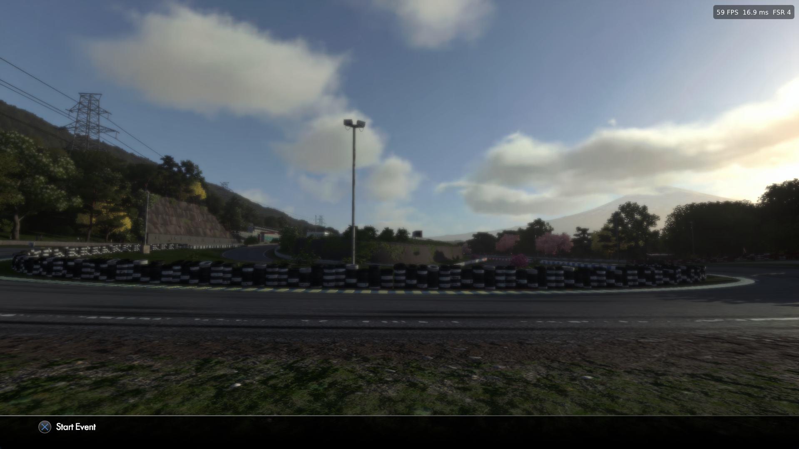

# DCport — Driveclub on Windows

The Windows backend of Driveclub Native: DRIVECLUB (PS4, v01.28: EU CUSA00003 or US CUSA00093) running natively on Windows. The game's own x86-64 code runs directly on the PC; its graphics are translated to Vulkan (shadPS4's renderer).

## 0.3.7

- **Fewer "Device lost" crashes.** The crash right after a car loads is gone in testing (RX 9070 XT): the "Object motion" pass, left over from the runtime DCport is built on, is off in DRIVECLUB (its FSR takes the motion from the game itself), and threaded recording is off by default (SETUP > Threading > On turns it on).
- **Intel CPUs (12th gen and later): random startup crash fixed** (`Fault: read access to 0 at guest offset 0x64db13`). On these CPUs an exception saves more on the stack, over memory the game still uses. The prepare step now finds the affected functions in your own game files (eboot and modules) and runs their memory accesses with the stack moved out of the way. Found by jony113. On AMD CPUs nothing changes except a tiny overhead.
- **Intel Arc GPUs:** FSR 3.1 is used; FSR 4 did not finish starting on Intel's driver.
- After a "Device lost" crash the log also shows the GPU address that faulted (where the driver supports it).
- Test builds of the launcher only update to their own final release or newer.

## 0.3.6

- **Render above 1080p removed.** The community resolution patches (1440p, 1800p, 4K) left part of the game's lighting at 1080p (a square in the top left of the picture) and races lost the GPU with them. The game renders at 1080p; on a 1440p or 4K window or screen the picture is scaled up with FSR 1 and sharpened, which ran without those crashes.
- **SETUP > Check for updates:** checks at any time (the launcher also checks at every start and downloads in the background).
- **Update-only folders are refused.** A folder with the 01.28 update package alone (eboot.bin but no `game.chc`) crashed at boot; the launcher now says to copy the update over the base game (01.00) and choose that folder.

## 0.3.5

- **Intel CPUs work.** DRIVECLUB uses an AMD-only instruction (SSE4a `EXTRQ`, 316 places in the 01.28 eboot); Intel CPUs closed the game at the first one (`0xC000001D`). On CPUs without SSE4a the prepare step now replaces each with an equivalent two-shift sequence (found and verified by jony113). AMD installs are unchanged.
- **Automatic updates.** The launcher checks this repository's releases when it starts, downloads the new version of its edition in the background (checked against GitHub's SHA-256) and offers **Restart to update**. Program files are replaced; saves, settings, controls, profiles, backups and `fsr4_411/` stay. Updating to 0.3.5 itself is manual, once.
- **FSR is anti-aliasing, not an upscaler.** FSR 3.1 / 4 / 4.1.1 run inside DRIVECLUB's own anti-aliasing step (native AA). Everything after that step, the game's effects and HUD, stays at 1080p, so there are no Quality, Balanced or Performance modes: those would need the rest of the frame at a higher size. The launcher and the in-game menu now say anti-aliasing.
- **Bigger screens:** the 1080p frame is scaled to a bigger window or screen with FSR 1 and sharpened (FSR edition).
- **Render above 1080p is optional, with a warning.** The community resolution patches leave part of the game's lighting at 1080p (a square in the top left of the picture, with or without FSR) and some races lose the GPU there. 1080p is the default and recommended.
- **The in-game Output resolution / Preset / Live resolution options are gone** (left over from the Bloodborne runtime this is built on): changing the output resolution mid-race lost the GPU.
- **Frame generation removed** because it did not work.
- **Language:** SETUP > Language, with the languages of your copy (EU: 14, US: English, French, Portuguese (Brazil), Spanish (Latin America)).
- Known: some races can still end with "Device lost" after a few minutes on some AMD cards (also in 0.3.4). Please send the log with its GPU markers.

## ⚡ New in 0.3.0: FSR 4.1.1, built on your own PC, in one click

AMD ships FSR 4.1.1 as a DirectX 12 DLL. DCport's **FSR 4.1.1 builder** turns your own copy of that DLL into native **Vulkan** anti-aliasing for Driveclub — no Wine, no Linux, no tools to install:

1. SETUP → Anti-aliasing (FSR) → **Set up FSR 4.1.1…**
2. Pick your `amd_fidelityfx_upscaler_dx12.dll` (4.1.x).
3. About two minutes later, choose **FSR 4.1.1** as the mode. Done.

What happens in those two minutes, all on your PC:

- **Records the real thing.** The builder runs your DLL once on DirectX 12 at 1080p and 1440p and records every pass of AMD's INT8 neural network, its weights and its constants (`fsr4cap`).
- **Translates it to Vulkan.** Each pass's DXIL shader becomes SPIR-V (`dxil-spirv`, the translator vkd3d-proton uses), in a portable form that runs on Windows drivers, which lack the Linux-only extension the exact translation needs.
- **Repairs stripped shaders.** DLLs with performance-rewritten shaders lose their resource names; the builder restores them from AMD's original shaders (downloaded from AMD's public FidelityFX SDK and only read, never run).
- **Checks everything.** The dispatch sequence, group counts, tensor sizes and constants of every pass are checked against the rules the Vulkan replay uses before anything is written.

The result, `fsr4_411/`, is replayed by the runtime every frame (about 1 ms at 1080p). Without the window: `DriveClub.exe --setup-fsr411 <path to the DLL>`.

Nothing of AMD's is in the download or in this repository: every player builds it from their own DLL. AMD's own DLL offers FSR 4.1.1 on Radeon RX 9000 cards only; other cards need a version of the DLL that lifts that limit.

Also new in 0.3.0: **FSR in every race** (0.2.0's FSR ran in menus only), a **PATCHES** tab, window size and render resolution settings.

## 0.3.4

- **Freeze mid-race fixed** (picture stops, sound loops). Two game threads waited for each other on a read-write lock: on PS4 a thread that already holds a read lock may take it again while a writer waits; the Windows lock made it wait behind the writer. Both of the game's lock APIs now follow the PS4 rule.
- **Frame generation: leave it off** (removed in 0.3.5 because it did not work).
- **GPU markers:** after a "Device lost" crash the log lists which GPU step was running (AMD cards, `VK_AMD_buffer_marker`). Send it with crash reports.
- **Player name:** SETUP > Game > Player name (saved in `dcport.ini` as `player_name`). The default is "Player".
- **Frame generation "Image only"** (game menu, for testing): frames from the pictures alone, without the game's depth and motion.
- Auto exposure: small GPU results the game reads back (such as brightness) are copied first when a frame's read-back budget runs out, so exposure keeps updating in busy scenes (the screen could stay too dark after bright-to-dark changes, or flicker).
- Colour-surface metadata reads (CMask) are answered as "not compressed" instead of stale memory, and logged once instead of every frame.
- Frame generation presents two images per frame: the swapchain now has enough acquire semaphores for that.

## 0.3.3 hotfix

- SETUP > Threading now shows the choice you click (it saved it, but kept showing Auto).
- The in-game menu's Motion blur checkbox is gone: it did not change the blur. To turn motion blur off, use PATCHES > "No motion blur or depth of field". The game's blur covers the movement between two frames, so it looks weaker above 30 FPS; 30 FPS shows the original look.

## 0.3.2 hotfix

- **Crash at 4K / under memory pressure fixed** (seen on an RTX 3080 10 GB within a minute: "FreeDeferred on an allocation that is not held"): two threads used the same staging-buffer list without a lock.
- **AMD RX 6000 mid-race crashes** ("Device lost", amdvlk64.dll): new **SETUP > Threading** (Auto / On / Off). Threaded command recording is off by default on AMD Radeon RX 6000 and older, which run fine without it, and on for other cards (NVIDIA, newer AMD). If the game crashes, try Off; if it runs fine, try On for more FPS.

## 0.3.1 hotfix

- US copies (CUSA00093) are accepted: the launcher said "patches need 1.28" for them although the game is 01.28. Versions now show as on the PS4 (01.28).
- Saves made with one region are used by the other when it has no save folder of its own (nothing is moved).
- In-game menu saves keep launcher settings in `dcport.ini` they do not manage.
- Clearer FSR 4 / 4.1.1 fallback messages (FSR 3.1 is used, and the menu says why).

## Download

Get the latest release from the Releases page:

- `DCport-<version>-windows-fsr.zip`: with FSR 3.1 and FSR 4 (FSR 4 needs a recent AMD or NVIDIA GPU)
- `DCport-<version>-windows.zip`: without FSR

No game files are included. You need your own dump of DRIVECLUB 01.28, EU (CUSA00003) or US (CUSA00093) (the folder with `eboot.bin` and the `game*.dat` files).

## Playing

1. Unzip anywhere and start `DriveClub.exe`.
2. The first time, choose your game folder. On the first PLAY, DCport prepares the game files on your PC (once, under a minute).
3. The launcher has six tabs:
   - **RACE**: game art, ready checks, PLAY, quick frame rate, window and FPS counter
   - **SETUP**: game folder, player name, language, frame rate (30–240, tested up to 120), window mode and size, FPS counter, threading; FSR edition: anti-aliasing (FSR 3.1 / 4 / 4.1.1), sharpness, FSR 4.1.1 set-up
   - **PATCHES**: community game patches (frame-rate patch type, no barriers, no reset, no motion blur/DOF, photo mode)
   - **CONTROLS**: keyboard and controller bindings
   - **GARAGE**: save profiles, backups with restore, shader cache, desktop shortcut, Add to Steam
   - **LOG**: last run's log, "Copy for bug report"
4. `DriveClub.exe --play` starts the game directly (used by the desktop shortcut and Steam entry).
5. DLC: put your own dumped DLC folders (each with its own `sce_sys`) inside your game folder.
6. In game, Insert (or L3+R3) opens the settings menu.

Requirements: Windows 10/11 64-bit, a CPU with AVX, a Vulkan 1.3 GPU.

### FSR edition extras (0.3.0)

- **FSR in every race:** Driveclub's TAA resolve comes in three variants (menus, races, others); FSR 3.1/4 replace all of them. The FPS counter names the FSR mode only while it really runs ("TAA" otherwise).
- **FSR 4.1.1 (optional, bring your own DLL):** SETUP > *Set up FSR 4.1.1…* runs your own `amd_fidelityfx_upscaler_dx12.dll` once on DirectX 12, translates its shaders to SPIR-V on your PC (`bin/fsr411`: fsr4cap, dxil-spirv, SPIRV-Tools) and writes `fsr4_411/`, which the runtime replays in Vulkan. Nothing of AMD's is in the release or in this repository; AMD's FidelityFX loader is downloaded from AMD's public SDK repository during set-up. AMD's own DLL offers FSR 4.1.1 on Radeon RX 9000 only.

## Source in this folder

- `launcher/`: the DCport launcher (Python 3.12, Tkinter, Pillow; frozen with PyInstaller via `build.sh fsr|nofsr`) and the first-run prepare tool (`launcher/prepare/`, needs [capstone](https://www.capstone-engine.org/) (BSD) for the red-zone analysis). Tests: `python -m pytest tests`.
- `runtime/driveclub-runtime.patch`: the Driveclub changes to the native PS4 runtime, against [Supermedo/bloodborne_pc](https://github.com/Supermedo/bloodborne_pc) commit `fce08780508a72f50d34a3d3a2926e746d12284c` (version 1.8.2). Apply with `git apply`, then build with `build.sh` in MSYS2 CLANG64.
- `runtime/fsr-vulkan.patch.txt`: one small change to its FSR-Vulkan submodule.
- `patches/Driveclub.xml`: community patches (60 FPS with deltatime and others).

## Windows port credits

DCport is built on other people's work: the native PS4 runtime by deadinside28 and Supermedo, and shadPS4's renderer. The Driveclub support, the fixes that make it playable (graphics glitches, lighting, frame rate, fonts, crashes), the launcher and the tools are new.

- **[BlackLineInteractive](https://github.com/BlackLineInteractive/Driveclub-Port):** the original Driveclub Native project and the macOS backend; reference for Driveclub's system library behaviour.
- **Native PS4 runtime:** deadinside28 ([bloodborne_pc](https://github.com/deadinside28/bloodborne_pc)) and the Windows port by Supermedo ([bloodborne_pc](https://github.com/Supermedo/bloodborne_pc)).
- **[shadPS4](https://github.com/shadps4-emu/shadPS4):** renderer, shader recompiler and libraries the runtime is built on.
- **[akitaonrails](https://github.com/akitaonrails/shadPS4):** shadPS4 investigation of Driveclub (MSAA depth resolve).
- **Also used:** [FSR-Vulkan](https://github.com/FireBurn/FSR-Vulkan) and the AMD FidelityFX SDK (FSR, FSR 3 frame generation), FSR 4 assets from [FireBurn/Q2RTX](https://github.com/FireBurn/Q2RTX); [dxil-spirv](https://github.com/HansKristian-Work/dxil-spirv) (MIT) and [SPIRV-Tools](https://github.com/KhronosGroup/SPIRV-Tools) (Apache 2.0) for the FSR 4.1.1 set-up; FreeType, SDL3, FFmpeg and the other libraries listed in `licenses/`.
- **Community patches** ([shadps4-emu/ps4_cheats](https://github.com/shadps4-emu/ps4_cheats)): illusion, u/Charlie_Muggins, kalaposfos.
- Windows port by **qnfn** (system functions, fonts, readbacks, upscaler integration, launcher).

## Legal disclaimer

- **No Proprietary Game Files:** This project does not distribute, host, or link to any copyrighted material, proprietary game assets, PKG dumps, ROMs, executables (eboot.bin), libraries (.prx), engine archives (.dat), audio, or textures. Users must provide their own legitimately acquired copy of Driveclub and of any DLC. On Windows, DCport reads it from your folder and builds its working files on your own PC; nothing from the game is ever uploaded or shared. Please do not ask for, or share, game files anywhere in this project.
- **Intellectual Property:** Driveclub is a registered trademark of Sony Interactive Entertainment LLC. All trademarks, service marks, game titles, and copyrighted assets belong to Sony Interactive Entertainment and Evolution Studios. PlayStation and PS4 are trademarks of Sony Interactive Entertainment Inc.
- **Educational and Preservation Purpose:** This repository is an independent reverse-engineering project conducted strictly for interoperability, software preservation, and educational purposes. It is not affiliated with, endorsed by, or sponsored by Sony Interactive Entertainment, Evolution Studios, or any associated entities.
- **Free:** DCport is free and always will be. If someone sold it to you, ask for your money back.
- **FSR (Windows):** AMD, FidelityFX and FSR are trademarks of Advanced Micro Devices, Inc.; DCport is not affiliated with AMD. The FSR edition's download includes FSR 4 assets from [FireBurn/Q2RTX](https://github.com/FireBurn/Q2RTX) under AMD's MIT license (`fsr4_shaders/LICENSE-FSR4-v07.txt`). They are not part of this repository. FSR 4.1.1 is never distributed: it is built on the player's PC from their own DLL.
- **No Warranty:** DCport is provided "as is", without warranty of any kind (see the GPL). Use it at your own risk and keep a backup of your saves.
- Rights holders with a concern can open an issue on this repository; we will respond promptly.

## License

GPL-2.0-or-later, like the runtime and shadPS4. Third-party components keep their own licenses.
